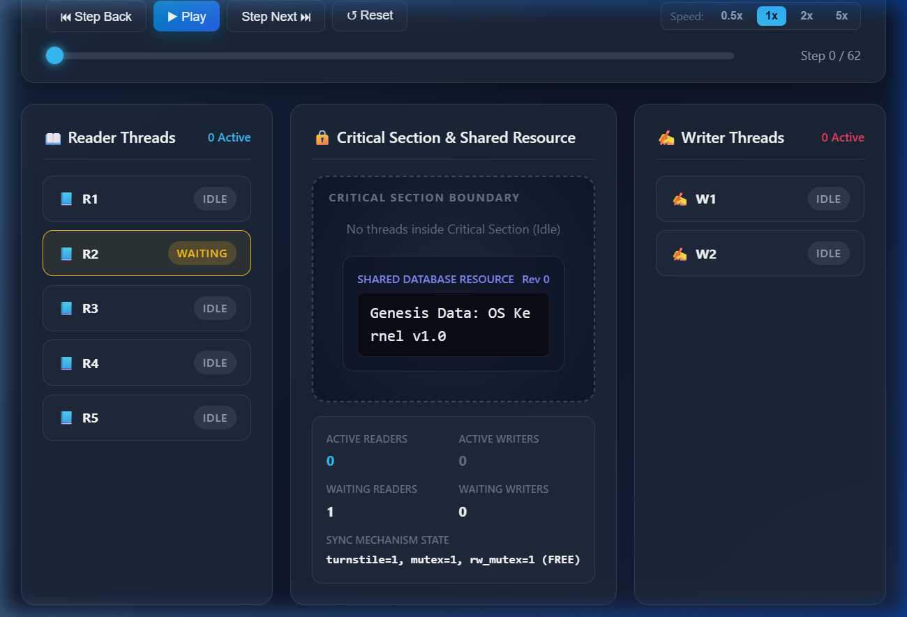
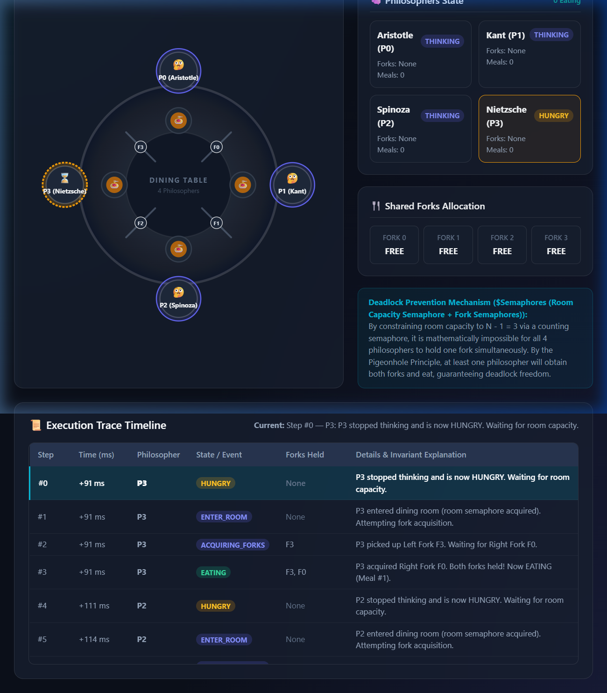

# Operating Systems Programming Assignment
## AI-Assisted Synchronization Algorithms with Program-Generated HTML Simulation
### Readers-Writers Problem and Dining Philosophers Problem

---

## 📋 Student & Submission Metadata
- **Student Name:** Deekshi R Gowda
- **University Serial / USN / Reg. No.:** NNM24IS064
- **Course:** Operating Systems (CS / IT)
- **Assignment Type:** Individual Programming Assignment
- **Academic Integrity Disclosure:** AI-assisted work developed in accordance with assignment regulations; all algorithms tested, documented, verified, and understood.

---

## 📌 Executive Summary
This project provides concurrent, multi-threaded solutions to two classic process synchronization challenges in modern Operating Systems:
1. **Readers-Writers Problem** implemented with:
   - **Semaphores** (Starvation-Free Turnstile + Mutex + Resource Semaphore)
   - **Monitors** (Condition Variables with Writer-Preference discipline)
2. **Dining Philosophers Problem (4 Philosophers)** implemented with:
   - **Semaphores** (Footman / Room Capacity Semaphore + Fork Semaphores)
   - **Monitors** (Condition Variables with Atomic Neighbor State Testing)

### 🌟 Key Feature: Program-Generated Interactive HTML Simulations
As mandated by the assignment guidelines, the HTML simulations are **not** static hand-crafted animations. Instead, the Python concurrency programs directly record execution traces during runtime and output rich, self-contained HTML visualizers. The simulations feature:
- Dark-mode glassmorphic interface with interactive controls (Play/Pause, Step Forward/Back, Reset, Speed Control from 0.5x to 5x, Timeline scrubber).
- Real-time visualization of Critical Section occupancy, reader/writer state badges, and shared resource modifications.
- Interactive circular dining table for the Dining Philosophers with SVG plates, dynamic fork allocation lines, and philosopher avatars (Thinking 💭, Hungry ⏳, Eating 🍝).
- Filterable execution event log matching the program's console output.
- **Zero external dependencies:** Works 100% offline without CDN scripts or internet connection.

---

## 📂 Repository Structure

```text
OS-Synchronization-Assignment/
|-- README.md                                # Project documentation and instructions
|-- common/
|   |-- html_templates.py                    # Reusable, self-contained HTML visualizer generator
|-- readers_writers/
|   |-- semaphore/
|   |   |-- readers_writers_semaphore.py     # Problem 1: Semaphore-based Readers-Writers
|   |-- monitor/
|       |-- readers_writers_monitor.py       # Problem 2: Monitor-based Readers-Writers
|-- dining_philosophers/
|   |-- semaphore/
|   |   |-- dining_philosophers_semaphore.py # Problem 3: 4-Philosopher Semaphore solution
|   |-- monitor/
|       |-- dining_philosophers_monitor.py   # Problem 4: 4-Philosopher Monitor solution
|-- generated_html/
|   |-- readers_writers_semaphore.html       # Generated HTML trace simulation 1
|   |-- readers_writers_monitor.html         # Generated HTML trace simulation 2
|   |-- dining_philosophers_semaphore.html   # Generated HTML trace simulation 3
|   |-- dining_philosophers_monitor.html     # Generated HTML trace simulation 4
|-- screenshots/
|   |-- readers_writers_semaphore.png        # Execution screenshot
|   |-- readers_writers_monitor.png          # Execution screenshot
|   |-- dining_philosophers_semaphore.png    # Execution screenshot
|   |-- dining_philosophers_monitor.png      # Execution screenshot
|-- ai_prompts/
|   |-- prompts.md                           # AI prompt log, iterations & reflections
|-- references/
|   |-- references.md                        # Academic bibliography and citations
|-- report/
    |-- Assignment_Report.md                 # Comprehensive technical assignment report
```

---

## 🛠️ Technology Stack & Dependencies

- **Programming Language:** Python 3 (Tested on Python 3.10+)
- **Standard Libraries Used:**
  - `threading` (POSIX-compatible threads, `Semaphore`, `Lock`, `Condition`)
  - `time`, `random` (Configurable non-preemptive delays for concurrency simulation)
  - `json`, `html`, `os`, `sys` (Data serialization and file output)
- **External Dependencies:** **None** (No `pip install` required!).
- **Browser Compatibility:** Works in Google Chrome, Microsoft Edge, Mozilla Firefox, and Apple Safari.

---

## 🚀 Build and Execution Instructions

### 1. Prerequisites
Ensure Python 3 is installed and added to your system PATH:
```bash
python --version
```

### 2. Running Individual Solutions

All programs can be run directly from the repository root:

#### A. Readers-Writers (Semaphore)
```bash
python readers_writers/semaphore/readers_writers_semaphore.py
```
*Generates:* `generated_html/readers_writers_semaphore.html`

#### B. Readers-Writers (Monitor)
```bash
python readers_writers/monitor/readers_writers_monitor.py
```
*Generates:* `generated_html/readers_writers_monitor.html`

#### C. Dining Philosophers (Semaphore)
```bash
python dining_philosophers/semaphore/dining_philosophers_semaphore.py
```
*Generates:* `generated_html/dining_philosophers_semaphore.html`

#### D. Dining Philosophers (Monitor)
```bash
python dining_philosophers/monitor/dining_philosophers_monitor.py
```
*Generates:* `generated_html/dining_philosophers_monitor.html`

### 3. Running All Programs in One Command
You can run all four implementations sequentially to regenerate all HTML visualizations:
```bash
python -c "import subprocess, sys; [subprocess.run([sys.executable, p], check=True) for p in ['readers_writers/semaphore/readers_writers_semaphore.py', 'readers_writers/monitor/readers_writers_monitor.py', 'dining_philosophers/semaphore/dining_philosophers_semaphore.py', 'dining_philosophers/monitor/dining_philosophers_monitor.py']]"
```

---

## 🌐 Opening and Viewing Generated HTML Simulations

Once executed, open any of the generated HTML files in your preferred browser:
- **Windows (PowerShell / CMD):**
  ```powershell
  start generated_html/readers_writers_semaphore.html
  start generated_html/readers_writers_monitor.html
  start generated_html/dining_philosophers_semaphore.html
  start generated_html/dining_philosophers_monitor.html
  ```
- **macOS:**
  ```bash
  open generated_html/readers_writers_semaphore.html
  ```
- **Linux:**
  ```bash
  xdg-open generated_html/readers_writers_semaphore.html
  ```
- Or double-click the files in File Explorer.

### Simulation Keyboard Shortcuts
- `Spacebar`: Toggle Play / Pause
- `Right Arrow (→)`: Step Forward one event
- `Left Arrow (←)`: Step Backward one event

---

## 📸 Sample Visualizations and Screenshots

### 1. Readers-Writers Problem (Semaphore & Monitor)

- **Top Bar:** Live metrics tracking Total Events, Active Reads, Active Writes, and Max Concurrent Readers.
- **Left Column:** Reader threads with color-coded status badges (`IDLE`, `WAITING`, `READING`).
- **Center Stage:** The Critical Section boundary showing active readers reading concurrently, or a writer holding exclusive access while updating the shared database record.
- **Right Column:** Writer threads (`IDLE`, `WAITING`, `WRITING`).
- **Bottom:** Step-by-step execution log with invariant verification.

### 2. Dining Philosophers Problem (4 Philosophers)

- **Round Dining Table:** Clean SVG layout showing the 4 philosophers and 4 shared forks.
- **Philosopher Nodes:** Dynamically glow purple when `THINKING`, amber when `HUNGRY`, and vibrant green with glowing aura when `EATING`.
- **Forks:** Transition from neutral grey to emerald green when picked up by the philosopher holding them.
- **Side Panel:** Live status cards for Aristotle (P0), Kant (P1), Spinoza (P2), and Nietzsche (P3), fork allocations, and deadlock-prevention proof callout.

---

## 🔬 Technical Synchronization Details

### 1. Readers-Writers: Semaphores vs. Monitors
| Dimension | Semaphore Implementation | Monitor Implementation |
| :--- | :--- | :--- |
| **Primitives** | `turnstile`, `mutex`, `rw_mutex` | Lock + `can_read`, `can_write` Condition Variables |
| **Mutual Exclusion** | Enforced explicitly across acquire/release pairs | Encapsulated implicitly in Monitor procedures |
| **Reader Concurrency** | First reader locks `rw_mutex`, last reader releases | `can_read.notify_all()` wakes up all waiting readers |
| **Starvation Prevention** | Turnstile enforces FIFO queueing for incoming threads | Writers given priority in `start_read()` while condition check |
| **Deadlock Vulnerability** | Risk if semaphore acquire order is inverted | Low; structured enter/exit monitor procedures |

### 2. Dining Philosophers: Deadlock & Starvation Resolution
- **Deadlock Condition Addressed:** Circular Wait.
- **Semaphore Approach:** Employs a Footman / Room Counting Semaphore with capacity $N - 1 = 3$. Because at most 3 philosophers can sit at the 4-fork table simultaneously, at least one philosopher is guaranteed by the Pigeonhole Principle to acquire both forks and eat, breaking circular wait.
- **Monitor Approach:** Evaluates neighbor states atomically in `_test(i)`:
  $$\text{Can Eat} \iff (\text{state}[i] == \text{HUNGRY} \land \text{state}[\text{left}] \ne \text{EATING} \land \text{state}[\text{right}] \ne \text{EATING})$$
  Forks are acquired atomically as a pair, eliminating the Hold-and-Wait condition.

---

## ⚠️ Known Limitations
1. **Host OS Thread Scheduling:** Thread scheduling is governed by the underlying operating system kernel scheduler and Python's GIL. While random jitter delays simulate diverse interleavings, true hardware real-time preemption is non-deterministic.
2. **Fixed Philosopher Count:** The Dining Philosophers programs are designed specifically for $N = 4$ philosophers as requested by the prompt. Modifying $N$ requires updating neighbor modulo calculations and the room semaphore capacity ($N-1$).

---

## 🤖 AI Assistance & Academic Integrity
- **AI Tool Used:** Google DeepMind Antigravity IDE (Gemini 3.8 Flash).
- **Prompt Log:** Detailed in [`ai_prompts/prompts.md`](ai_prompts/prompts.md).
- **Declaration:** All algorithms and code were thoroughly reviewed, tested, and understood by the student.

---

## 📚 References
A complete list of textbooks, academic papers, and official documentation is available in [`references/references.md`](references/references.md).
